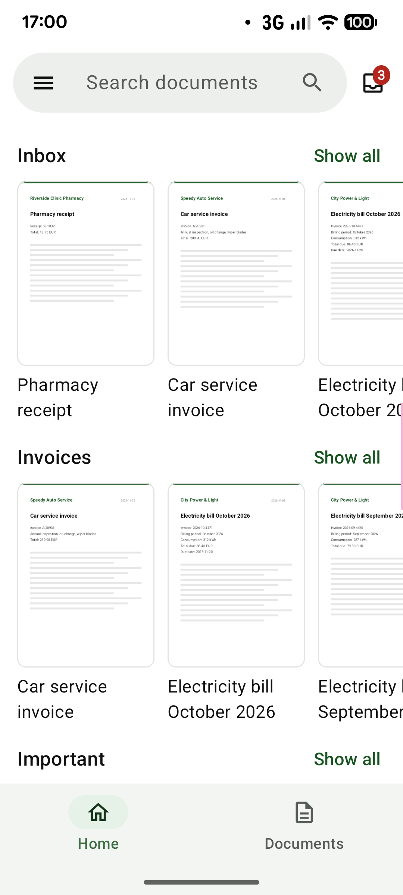
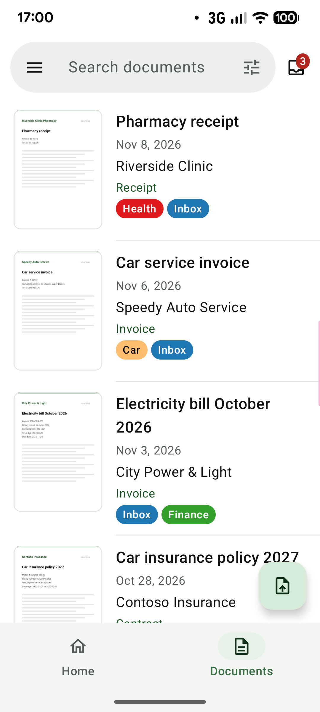
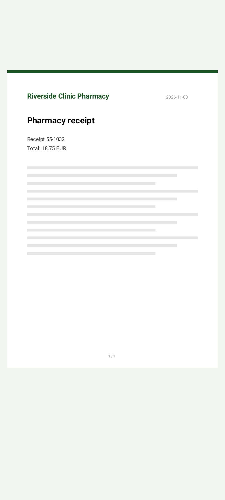
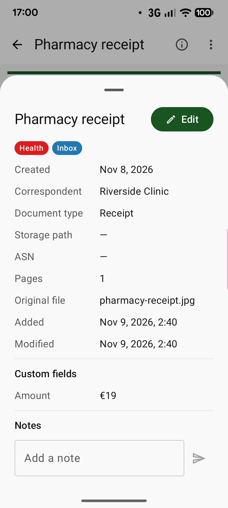
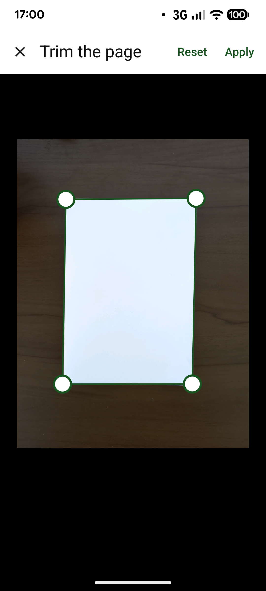
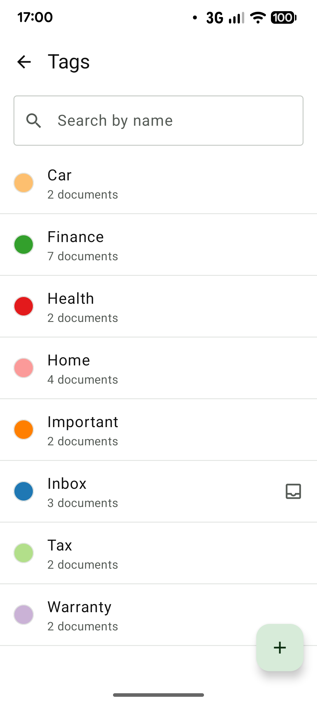

# paperless-android

[English](README.md) | 日本語

Kotlin で実装した [Paperless-ngx](https://github.com/paperless-ngx/paperless-ngx) の Android クライアントです。

> **このリポジトリについて：** GitHub のリポジトリ
> （[naoya0117/paperless-android](https://github.com/naoya0117/paperless-android)）は**ミラー**です。
> 開発（Issue・レビュー・CI）は作者の Gitea サーバーで行い、そこから GitHub へ反映しています。
>
> アプリとリポジトリの概要を 1 ページにまとめたものが [`docs/index.ja.md`](docs/index.ja.md) です（GitHub Pages での公開にも使えます）。

## スクリーンショット

| ホーム | 文書の一覧 | ビューワ |
|:---:|:---:|:---:|
|  |  |  |
| **詳細** | **スキャン** | **タグ** |
|  |  |  |

画面に写っている文書はサンプルのデータです。

## 動作要件

- **Android 10（API レベル 29）以降**
- **Paperless-ngx 3.0.0 以降**（REST API バージョン 10）
- Paperless-ngx のユーザーに **UI 設定の閲覧権限**（`view_uisettings`）が必要です（サインインの確認に使用します）
- HTTPS で接続する場合、サーバー証明書が Android に信頼されている必要があります。
  プライベート CA で発行した証明書を使う場合は、端末に CA 証明書をインストールしてください。

## インストール

[GitHub のリリース](https://github.com/naoya0117/paperless-android/releases)から APK（`paperless-android-<バージョン>.apk`）を
ダウンロードしてインストールしてください。各リリースに APK の SHA-256 を記載しています。

> **F-Droid について：** まだ F-Droid には掲載されていません（掲載を目指しています）。
> F-Droid のアプリは F-Droid がビルドして署名するため、掲載された場合、ここの APK とは署名が異なり、
> 互いに上書きして更新することはできません。
> 切り替えるときは、先にアプリをアンインストールする必要があります（アカウントを含むアプリのデータも削除されます）。

APK は次の証明書（SHA-256）で署名しています。

```text
56:2B:80:8B:01:75:4F:9E:C2:14:50:E6:8D:4C:77:EB:09:5F:32:B6:36:92:B6:D9:51:B9:26:5F:00:C2:B0:47
```

ダウンロードした APK を確かめるには、Android SDK の build-tools にある `apksigner` を実行します（例はバージョン 0.1.0）。
表示される `Signer #1 certificate SHA-256 digest` が `562b808b01754f9ec21450e68d4c77eb095f32b63692b6d951b9265f00c2b047`（同じ値を小文字・コロンなしで表したもの）であれば正しい APK です。

```bash
apksigner verify --print-certs paperless-android-0.1.0.apk
```

## 機能

- **文書**：ダッシュボードの保存済みビューを並べたホーム画面、大きなサムネイルの文書一覧（オフラインでも表示）、受信箱、ごみ箱からの復元、
  並び替え・絞り込み（タグ・担当者・文書の種類・保存先・作成日）付きの全文検索
- **ビューワ**：PDF・画像の表示、全画面表示、ピンチでの拡大、文書内の検索。メモ・カスタムフィールド付きの詳細、編集、
  共有・他のアプリで開く・ダウンロード・削除
- **文書の追加**：カメラでのスキャン（複数ページを 4 隅でトリミング・補正して 1 つの PDF に）、ファイルのアップロードや
  他のアプリからの共有（複数の画像を 1 つの文書にまとめることも可能）。アップロードは待ち行列に入り、バックグラウンドで送信
- **整理**：タグ・担当者・文書の種類・保存先の管理、保存済みビュー
- **接続**：複数のアカウント、パスワード（2 段階認証を含む）または API トークン、独自のリクエストヘッダー、
  クライアント証明書（mTLS）、プライベート CA の証明書

最新の Paperless-ngx REST API（バージョン 10）に対応し、ご自身のサーバーとだけ通信します。

## ビルド

JDK 17 以降と Android SDK（`ANDROID_HOME` または `local.properties` で指定）が必要です。

1 行目はデバッグ APK（アプリケーション ID の末尾に `.debug` が付きます）を、2 行目はコンパイル、
ユニットテスト、Android Lint、ktlint を実行します。

```bash
./gradlew assembleDebug
./gradlew build
```

### デモ版

サーバーなしで動くデモ版です。アプリに内蔵したサーバーに自動でログインし、サンプルの文書・ラベル・保存済みビューが
表示されます。編集・メモ・ごみ箱の操作はメモリ上だけで反映され、アプリを再起動するとサンプルのデータは元に戻ります
（アプリのキャッシュには、更新されるまで以前の変更が残ることがあります）。アップロードは使えません。
お試しやスクリーンショット用に手元でだけビルドするもので、リリースには含めません。通常のアプリと並べて
インストールできます（アプリケーション ID の末尾に `.demo` が付きます）。

```bash
./gradlew :app:assembleDemo
```

APK は `app/build/outputs/apk/demo/app-demo.apk` に出力されます。

リリース APK は、次の Gradle プロパティがすべて設定されている場合のみ署名されます
（例：`~/.gradle/gradle.properties` に記述）。

```properties
paperless.signing.storeFile=/path/to/release.jks
paperless.signing.storePassword=...
paperless.signing.keyAlias=...
paperless.signing.keyPassword=...
```

## 謝辞

本プロジェクトは、Anton Stubenbord 氏およびコントリビューターによるコミュニティ製アプリ
[paperless-mobile](https://github.com/astubenbord/paperless-mobile)（Flutter 製の Paperless-ngx クライアント）を参考にしています。
機能構成や API の利用方法を、この Kotlin 実装のリファレンスとしています。

本プロジェクトは、現行の Paperless-ngx REST API（バージョン 10）に合わせて実装しています
（タスクのページング、タグ階層、ごみ箱、`custom_field_query` など）。

本プロジェクトは独立したプロジェクトであり、paperless-mobile および Paperless-ngx プロジェクトとは提携・公認の関係にありません。

## ライセンス

Copyright (C) 2026 Naoya Matsuhashi

本プログラムはフリーソフトウェアです。フリーソフトウェア財団によって発行された
GNU 一般公衆利用許諾書（GNU General Public License）バージョン 3、
または（あなたの選択により）それ以降のバージョンが定める条件の下で、
再頒布および改変することができます。

本プログラムは有用であることを願って頒布されますが、**全くの無保証**です。
商品性や特定の目的への適合性に関する暗黙の保証もありません。
詳しくは GNU 一般公衆利用許諾書をご覧ください。

あなたは本プログラムと共に GNU 一般公衆利用許諾書の写しを受け取っているはずです。
受け取っていない場合は <https://www.gnu.org/licenses/> をご覧ください。

ライセンス全文は [LICENSE](LICENSE) を参照してください（法的に有効なのは英語の原文です）。

### サードパーティ

- [paperless-mobile](https://github.com/astubenbord/paperless-mobile) — GPL-3.0
- [Paperless-ngx](https://github.com/paperless-ngx/paperless-ngx) — GPL-3.0

アプリに含まれるオープンソースのライブラリ（Apache License 2.0。2 つは MIT・BSD 3-Clause）と、そのライセンス・表示事項は、アプリのメニューの
**このアプリについて** で確認できます。許可していないライセンスの依存関係があるとき（`app/build.gradle.kts` の `aboutLibraries`）や、
NOTICE ファイルを含むライブラリが `app/src/main/res/raw/third_party_notices.txt` にないときは、ビルドが失敗します。
