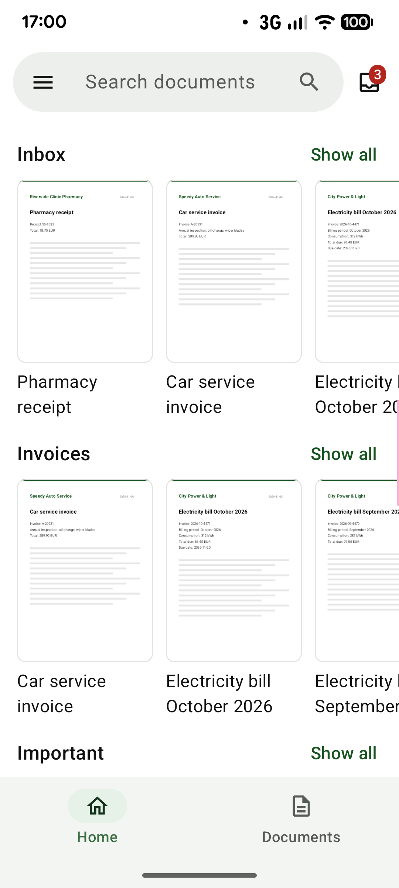
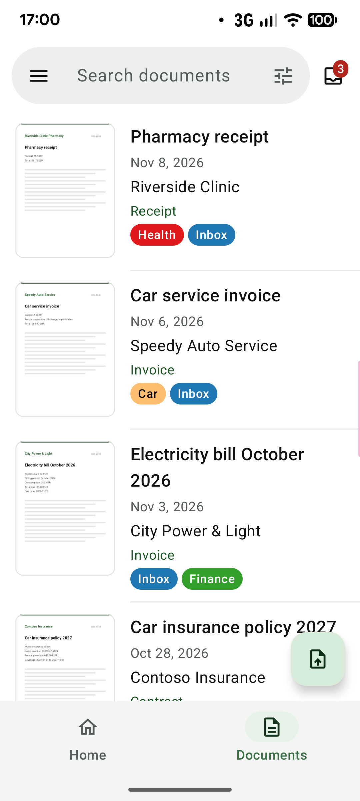
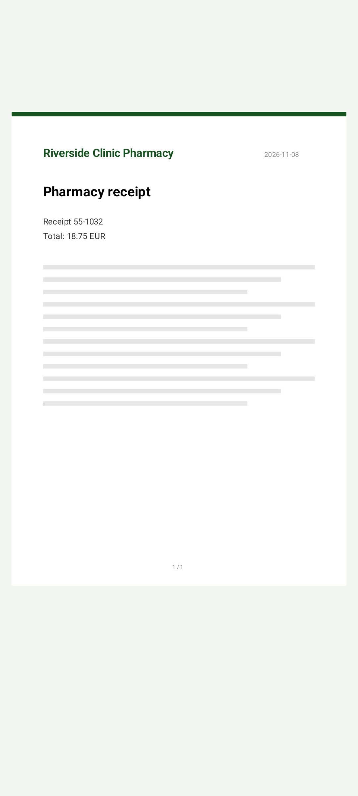
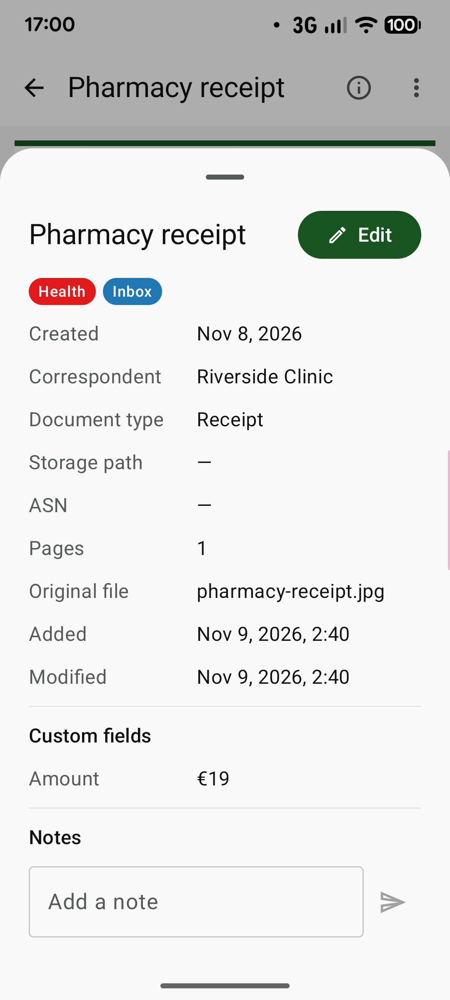
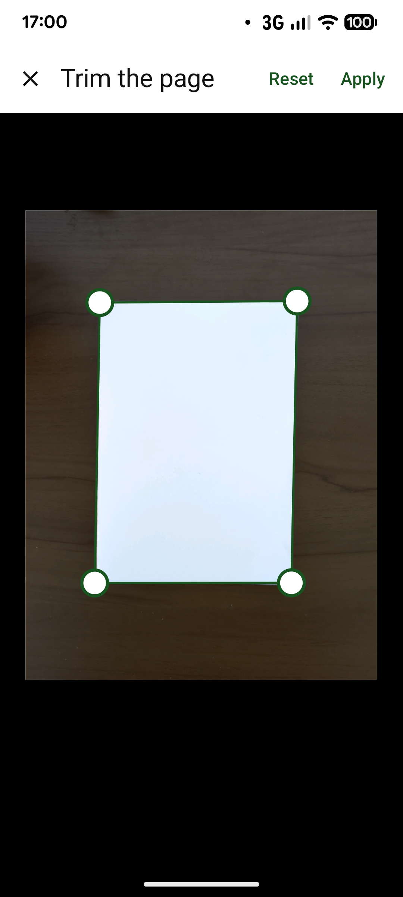
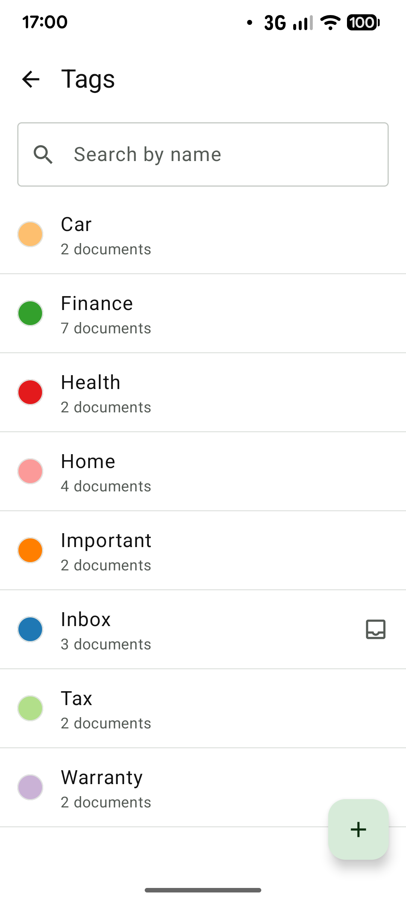

# paperless-android

English | [日本語](README.ja.md)

An Android client for [Paperless-ngx](https://github.com/paperless-ngx/paperless-ngx), written in Kotlin.

> **About this repository:** the repository on GitHub
> ([naoya0117/paperless-android](https://github.com/naoya0117/paperless-android)) is a **mirror**.
> Development (issues, reviews and CI) takes place on the author's own Gitea server, and the changes are pushed to
> GitHub from there.
>
> [`docs/index.md`](docs/index.md) describes the app and the repository on one page (it can also be published
> with GitHub Pages).

## Screenshots

| Home | Documents | Viewer |
|:---:|:---:|:---:|
|  |  |  |
| **Details** | **Scanning** | **Tags** |
|  |  |  |

The documents shown are sample data.

## Requirements

- **Android 10 (API level 29) or later**
- **Paperless-ngx 3.0.0 or later** (REST API version 10)
- The Paperless-ngx user needs the **UI settings view permission** (`view_uisettings`), which the app uses to validate the sign-in
- To connect over HTTPS, the server certificate must be trusted by Android.
  To use a certificate issued by a private CA, install the CA certificate on the device.

## Installation

Download the APK (`paperless-android-<version>.apk`) from the
[releases on GitHub](https://github.com/naoya0117/paperless-android/releases) and install it.
Each release lists the APK's SHA-256.

> **F-Droid:** the app is not on F-Droid yet; a listing there is planned. An app on F-Droid is built and signed
> by F-Droid, so it would have a different signature from the APK here, and neither could update the other:
> switching would mean uninstalling the app first (its data, including the accounts, is removed with it).

The APK is signed with the following certificate (SHA-256):

```text
56:2B:80:8B:01:75:4F:9E:C2:14:50:E6:8D:4C:77:EB:09:5F:32:B6:36:92:B6:D9:51:B9:26:5F:00:C2:B0:47
```

To check a downloaded APK, run `apksigner` from the Android SDK build tools (here for version 0.1.0). The
`Signer #1 certificate SHA-256 digest` it prints must be `562b808b01754f9ec21450e68d4c77eb095f32b63692b6d951b9265f00c2b047` (the same value in lowercase, without colons).

```bash
apksigner verify --print-certs paperless-android-0.1.0.apk
```

## Features

- **Documents**: home screen with the saved views of the dashboard; document lists with large thumbnails, available
  offline; inbox; trash with restore; full-text search with sorting and filters (tags, correspondent, document type, storage path, created date)
- **Viewer**: PDFs and images, full screen, pinch to zoom, search within the document; details with notes and
  custom fields; editing; share, open in another app, download, delete
- **Adding documents**: scanning with the camera (several pages, cropped to their corners and enhanced, as one PDF);
  uploading files or sharing them from other apps, several images as one document; uploads queued and sent in the
  background
- **Organizing**: tags, correspondents, document types and storage paths; saved views
- **Connections**: several accounts; password (with two-factor authentication) or API token; custom request
  headers, client certificates (mTLS) and private CA certificates

The app supports the current Paperless-ngx REST API (version 10) and talks only to your server.

## Building

Requires JDK 17 or later and the Android SDK (`ANDROID_HOME` or `local.properties`).

The first command builds the debug APK (application ID suffix `.debug`); the second compiles, runs the unit
tests, Android Lint and ktlint.

```bash
./gradlew assembleDebug
./gradlew build
```

### Demo build

A demo of the app that needs no server: it signs in to a server built into the app, with sample documents,
labels and saved views. Changes (editing, notes, the trash) are kept in memory only: after a restart the
sample data starts over (the app's cache may still show earlier changes until it is refreshed). Uploading is
not available. It is meant for trying the app and for screenshots, built locally only, and is
not part of the releases. It can be installed next to the regular app (application ID suffix `.demo`).

```bash
./gradlew :app:assembleDemo
```

The APK is written to `app/build/outputs/apk/demo/app-demo.apk`.

The release APK is unsigned unless all of the following Gradle properties are set
(e.g. in `~/.gradle/gradle.properties`):

```properties
paperless.signing.storeFile=/path/to/release.jks
paperless.signing.storePassword=...
paperless.signing.keyAlias=...
paperless.signing.keyPassword=...
```

## Acknowledgements

This project is based on and inspired by the community app
[paperless-mobile](https://github.com/astubenbord/paperless-mobile) by Anton Stubenbord and contributors,
a Flutter client for Paperless-ngx. Its feature set and API usage are used as a reference for this Kotlin implementation.

This project is written for the current Paperless-ngx REST API (version 10), including paginated tasks,
tag hierarchy, trash and `custom_field_query`.

This is an independent project and is not affiliated with, or endorsed by, the paperless-mobile or Paperless-ngx projects.

## License

Copyright (C) 2026 Naoya Matsuhashi

This program is free software: you can redistribute it and/or modify
it under the terms of the GNU General Public License as published by
the Free Software Foundation, either version 3 of the License, or
(at your option) any later version.

This program is distributed in the hope that it will be useful,
but WITHOUT ANY WARRANTY; without even the implied warranty of
MERCHANTABILITY or FITNESS FOR A PARTICULAR PURPOSE.  See the
GNU General Public License for more details.

You should have received a copy of the GNU General Public License
along with this program.  If not, see <https://www.gnu.org/licenses/>.

See [LICENSE](LICENSE) for the full text.

### Third-party notices

- [paperless-mobile](https://github.com/astubenbord/paperless-mobile) — GPL-3.0
- [Paperless-ngx](https://github.com/paperless-ngx/paperless-ngx) — GPL-3.0

The open source libraries in the app (Apache License 2.0; MIT and BSD 3-Clause for two of them), their licenses and notices are
listed in the app under **About** in the menu. The build fails if a dependency's license is not on the allowed list
(`aboutLibraries` in `app/build.gradle.kts`), or if a library with a NOTICE file is missing from
`app/src/main/res/raw/third_party_notices.txt`.
