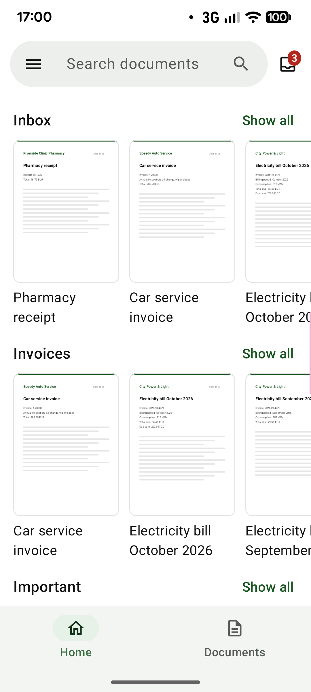
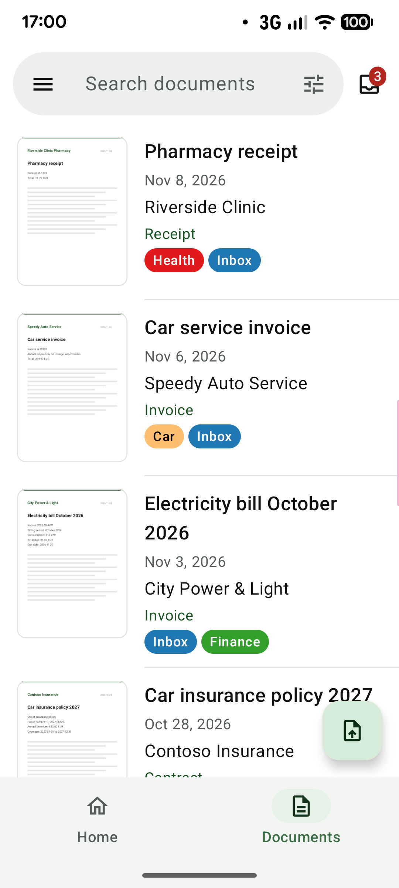
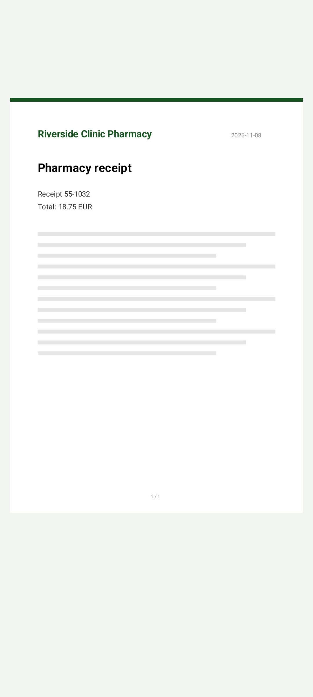
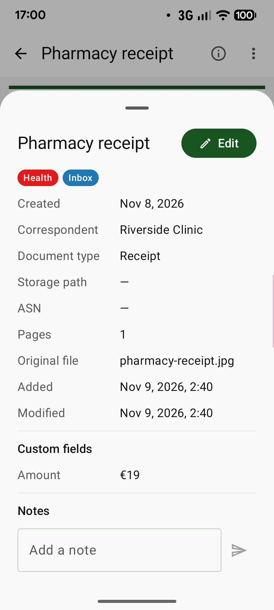
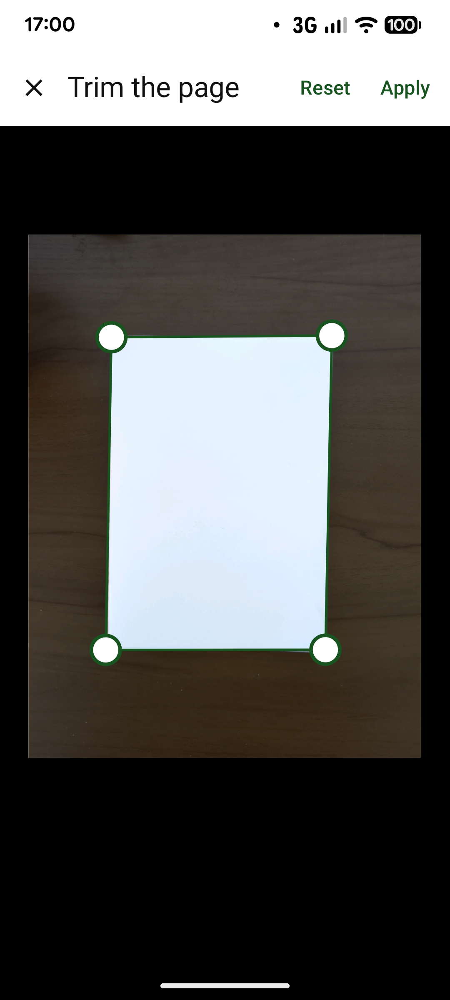
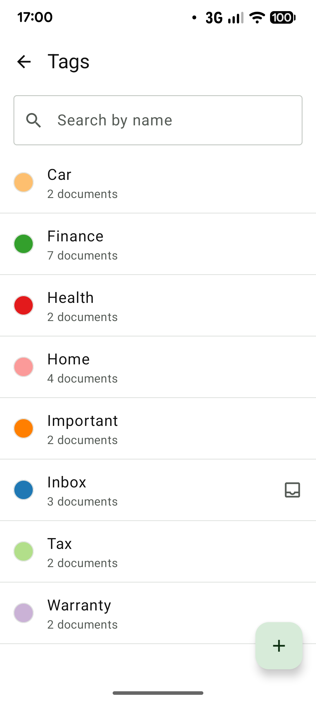

# paperless-android

[English](index.md) | 日本語

paperless-android は、自分で運用する文書管理システム [Paperless-ngx](https://docs.paperless-ngx.com/) の Android クライアントです。
ご自身のサーバーとだけ通信し、それ以外にデータを送りません。

- ソースコード：[naoya0117/paperless-android](https://github.com/naoya0117/paperless-android)（ミラーです。下記の「リポジトリについて」を参照）
- ダウンロード：[リリース](https://github.com/naoya0117/paperless-android/releases)
- ライセンス：GPL-3.0-or-later

## スクリーンショット

| ホーム | 文書の一覧 | ビューワ |
|:---:|:---:|:---:|
|  |  |  |
| **詳細** | **スキャン** | **タグ** |
|  |  |  |

画面に写っている文書はサンプルのデータです。

## 機能

- **文書**：ダッシュボードの保存済みビューを並べたホーム画面、大きなサムネイルの文書一覧（オフラインでも表示）、受信箱、ごみ箱からの復元、並び替え・絞り込み（タグ・担当者・文書の種類・保存先・作成日）付きの全文検索
- **ビューワ**：PDF・画像の表示、全画面表示、ピンチでの拡大、文書内の検索。メモ・カスタムフィールド付きの詳細、編集、共有・他のアプリで開く・ダウンロード・削除
- **文書の追加**：カメラでのスキャン（複数ページを 4 隅でトリミング・補正して 1 つの PDF に）、ファイルのアップロードや他のアプリからの共有（複数の画像を 1 つの文書にまとめることも可能）。アップロードは待ち行列に入り、バックグラウンドで送信
- **整理**：タグ・担当者・文書の種類・保存先の管理、保存済みビュー
- **接続**：複数のアカウント、パスワード（2 段階認証を含む）または API トークン、独自のリクエストヘッダー、クライアント証明書（mTLS）、プライベート CA の証明書

## 動作要件

- **Android 10（API レベル 29）以降**
- **Paperless-ngx 3.0.0 以降**（REST API バージョン 10）
- Paperless-ngx のユーザーに **UI 設定の閲覧権限**（`view_uisettings`）が必要です（サインインの確認に使用します）
- HTTPS で接続する場合、サーバー証明書が Android に信頼されている必要があります。プライベート CA で発行した証明書を使う場合は、端末に CA 証明書をインストールしてください

## インストール

[GitHub のリリース](https://github.com/naoya0117/paperless-android/releases)から APK（`paperless-android-<バージョン>.apk`）をダウンロードしてインストールしてください。
各リリースに APK の SHA-256 を記載しています。
現在の配布はここだけです。

APK は次の証明書（SHA-256）で署名しています。

```text
56:2B:80:8B:01:75:4F:9E:C2:14:50:E6:8D:4C:77:EB:09:5F:32:B6:36:92:B6:D9:51:B9:26:5F:00:C2:B0:47
```

ダウンロードした APK を確かめるには、Android SDK の build-tools にある `apksigner` を実行します（例はバージョン 0.1.1）。
表示される `Signer #1 certificate SHA-256 digest` が `562b808b01754f9ec21450e68d4c77eb095f32b63692b6d951b9265f00c2b047`（同じ値を小文字・コロンなしで表したもの）であれば正しい APK です。

```bash
apksigner verify --print-certs paperless-android-0.1.1.apk
```

### F-Droid について

**まだ F-Droid には掲載されていません。**
掲載を目指しています。
F-Droid のアプリは F-Droid がビルドして署名するため、掲載された場合、リリースの APK とは署名が異なり、互いに上書きして更新することはできません。
切り替えるときは、先にアプリをアンインストールする必要があります（アカウントを含むアプリのデータも削除されます）。

ビルドの準備は済んでいます。
依存関係のリポジトリは `google()` と `mavenCentral()` だけを宣言し、鍵がなければリリースビルドは署名なしになり、ストアの説明文とスクリーンショットは `fastlane/metadata/android/` に置いています。

## リポジトリについて

開発（Issue・レビュー・CI）は作者の Gitea サーバーで行っています。
GitHub のリポジトリはそこから反映している**ミラー**で、リリースの公開先でもあります。

### 構成

| パス | 内容 |
|---|---|
| `app/` | Android アプリ本体。画面遷移、「このアプリについて」、Hilt の設定、デモ版（`src/demo`、`demo` ビルドタイプ） |
| `core/model/` | ドメインの型（文書・ラベル・保存済みビュー・アカウント・タスク・アップロード） |
| `core/network/` | Paperless-ngx の REST クライアント（API バージョン 10）。エンドポイント、認証、TLS の設定 |
| `core/data/` | ネットワーク・キャッシュ・設定をまとめるリポジトリ。アップロードの待ち行列を処理するワーカー |
| `core/database/` | Room のデータベース。オフライン表示用の文書キャッシュとアップロードの待ち行列 |
| `core/datastore/` | アカウント。秘密の情報（トークン・独自のヘッダー）は Android Keystore の鍵で暗号化して保存 |
| `feature/login/` | サインイン。サーバー URL、パスワードまたは API トークン、2 段階認証 |
| `feature/documents/` | ホーム、文書の一覧、検索と絞り込み、ビューワ、詳細と編集、ごみ箱 |
| `feature/uploads/` | カメラでのスキャン、ページのトリミング、アップロードの一覧と通知 |
| `feature/labels/` | タグ・担当者・文書の種類・保存先 |
| `build-logic/` | 各モジュールで共有する Gradle の規約プラグイン |
| `fastlane/metadata/android/` | ストアの説明文・アイコン・スクリーンショット・変更履歴（F-Droid の形式） |
| `tools/paperless-dev/` | 実際の API の応答を確認するための使い捨ての Paperless-ngx（Docker Compose） |
| `docs/` | このページと[リリース手順](release.md) |

### 技術

Kotlin で実装しています。
画面は Jetpack Compose と Material 3、依存性注入は Hilt、REST クライアントは Retrofit・OkHttp と kotlinx.serialization、
オフラインのキャッシュは Room、アカウントの保存は DataStore、一覧は Paging 3、アップロードは WorkManager、
スキャンは CameraX、サムネイルは Coil、アプリ内のライセンス一覧は AboutLibraries を使っています。
バージョンは [`gradle/libs.versions.toml`](https://github.com/naoya0117/paperless-android/blob/main/gradle/libs.versions.toml) にまとめています。
`minSdk` は 29、`compileSdk`・`targetSdk` は 37 です。

### ビルド

JDK 17 以降と Android SDK（`ANDROID_HOME` または `local.properties` で指定）が必要です。

```bash
./gradlew assembleDebug   # デバッグ APK（アプリケーション ID の末尾に .debug）
./gradlew build           # コンパイル、ユニットテスト、Android Lint、ktlint
```

リリース APK は、署名のプロパティ（`paperless.signing.*`）を設定しないと署名なしになります。
設定の方法は[リリース手順](release.md)に書いています。

サーバーなしで動くデモ版があります。
アプリに内蔵したサーバーに自動でログインし、サンプルの文書・ラベル・保存済みビューが表示されます。
編集などはメモリ上だけで反映され、アップロードは使えません。
お試しやスクリーンショット用に手元でだけビルドするもので、リリースには含めません。
通常のアプリと並べてインストールできます（アプリケーション ID の末尾に `.demo` が付きます）。

```bash
./gradlew :app:assembleDemo   # app/build/outputs/apk/demo/app-demo.apk
```

### リリース

バージョンは `gradle.properties` にあります。
`paperless.versionName` はセマンティック バージョニングに従い、`paperless.versionCode` が `メジャー * 10000 + マイナー * 100 + パッチ` になっていることをビルドが確認します。
GitHub のミラーに `vX.Y.Z` のタグを push すると、署名済みの APK をビルドし、[`CHANGELOG.md`](https://github.com/naoya0117/paperless-android/blob/main/CHANGELOG.md) から取り出した説明を付けた下書きのリリースを作ります。
実機で APK を確認してから手動で公開します。
署名鍵やスクリーンショットを含む手順の全体は[リリース手順](release.md)にあります。

## 謝辞

本プロジェクトは、Anton Stubenbord 氏およびコントリビューターによるコミュニティ製アプリ [paperless-mobile](https://github.com/astubenbord/paperless-mobile)（Flutter 製の Paperless-ngx クライアント）を参考にしています。
機能構成や API の利用方法を、この Kotlin 実装のリファレンスとしています。
本プロジェクトは、現行の Paperless-ngx REST API（バージョン 10）に合わせて実装しています（タスクのページング、タグ階層、ごみ箱、`custom_field_query` など）。

本プロジェクトは独立したプロジェクトであり、paperless-mobile および Paperless-ngx プロジェクトとは提携・公認の関係にありません。

## ライセンス

Copyright (C) 2026 Naoya Matsuhashi

本プログラムはフリーソフトウェアです。
フリーソフトウェア財団によって発行された GNU 一般公衆利用許諾書（GNU General Public License）バージョン 3、
または（あなたの選択により）それ以降のバージョンが定める条件の下で、再頒布および改変することができます。
本プログラムは有用であることを願って頒布されますが、**全くの無保証**です。
商品性や特定の目的への適合性に関する暗黙の保証もありません。
詳しくは[ライセンス全文](https://github.com/naoya0117/paperless-android/blob/main/LICENSE)（法的に有効なのは英語の原文です）をご覧ください。

アプリに含まれるオープンソースのライブラリと、そのライセンス・表示事項は、アプリのメニューの**このアプリについて**で確認できます。
