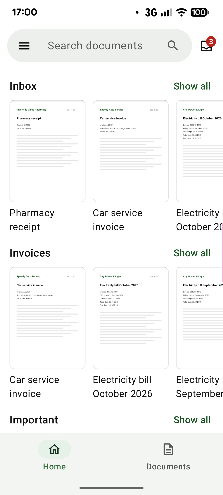
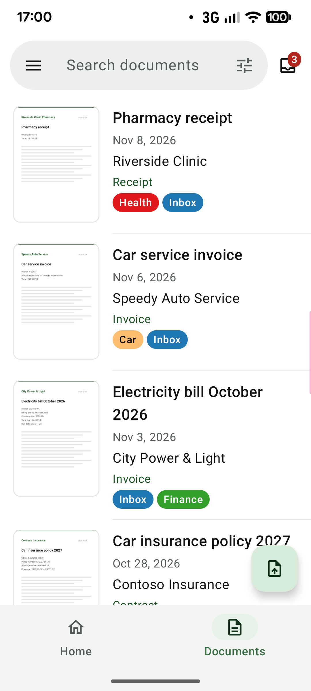
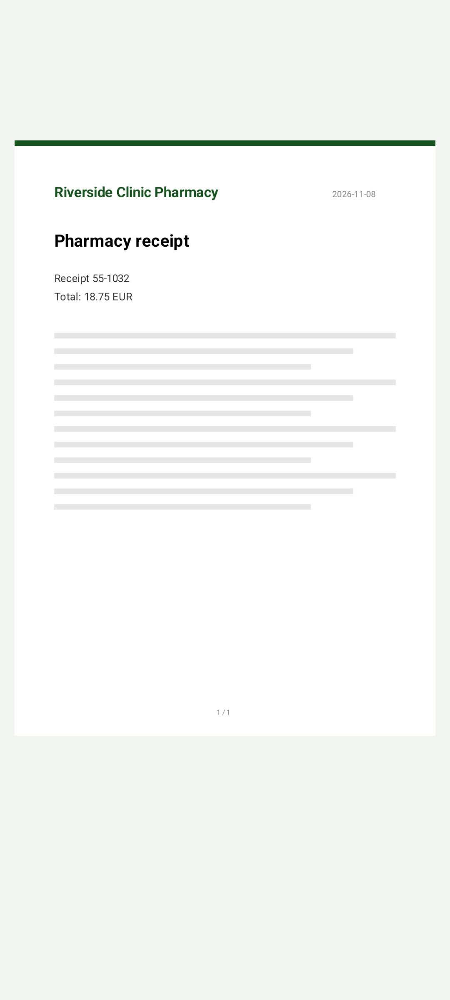
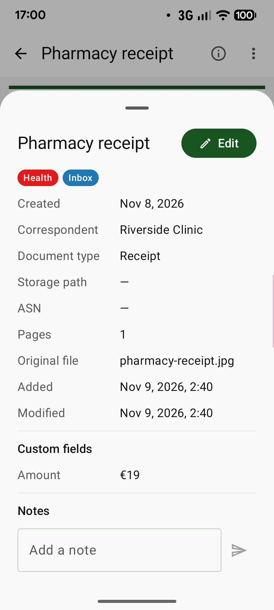
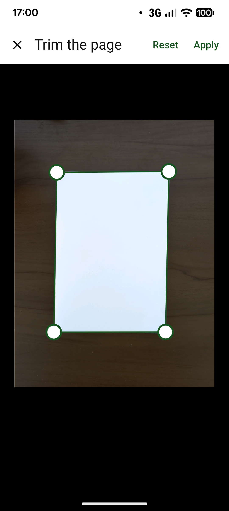
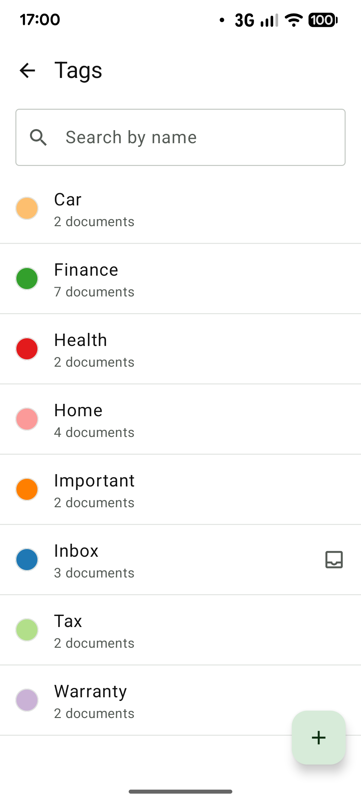

# paperless-android

English | [日本語](index.ja.md)

paperless-android is an Android client for [Paperless-ngx](https://docs.paperless-ngx.com/), the self-hosted
document management system. It works with your own server: the app talks to that server and to nothing else.

- Source code: [naoya0117/paperless-android](https://github.com/naoya0117/paperless-android) (a mirror; see
  [About the repository](#about-the-repository))
- Download: [releases](https://github.com/naoya0117/paperless-android/releases)
- License: GPL-3.0-or-later

## Screenshots

| Home | Documents | Viewer |
|:---:|:---:|:---:|
|  |  |  |
| **Details** | **Scanning** | **Tags** |
|  |  |  |

The documents shown are sample data.

## Features

- **Documents**: home screen with the saved views of the dashboard; document lists with large thumbnails,
  available offline; inbox; trash with restore; full-text search with sorting and filters (tags, correspondent,
  document type, storage path, created date)
- **Viewer**: PDFs and images, full screen, pinch to zoom, search within the document; details with notes and
  custom fields; editing; share, open in another app, download, delete
- **Adding documents**: scanning with the camera (several pages, cropped to their corners and enhanced, as one
  PDF); uploading files or sharing them from other apps, several images as one document; uploads queued and sent
  in the background
- **Organizing**: tags, correspondents, document types and storage paths; saved views
- **Connections**: several accounts; password (with two-factor authentication) or API token; custom request
  headers, client certificates (mTLS) and private CA certificates

## Requirements

- **Android 10 (API level 29) or later**
- **Paperless-ngx 3.0.0 or later** (REST API version 10)
- The Paperless-ngx user needs the **UI settings view permission** (`view_uisettings`), which the app uses to
  validate the sign-in
- To connect over HTTPS, the server certificate must be trusted by Android. To use a certificate issued by a
  private CA, install the CA certificate on the device.

## Installation

Download the APK (`paperless-android-<version>.apk`) from the
[releases](https://github.com/naoya0117/paperless-android/releases) and install it. Each release lists the APK's
SHA-256. This is currently the only place the app is published.

The APK is signed with the following certificate (SHA-256):

```text
56:2B:80:8B:01:75:4F:9E:C2:14:50:E6:8D:4C:77:EB:09:5F:32:B6:36:92:B6:D9:51:B9:26:5F:00:C2:B0:47
```

To check a downloaded APK, run `apksigner` from the Android SDK build tools (here for version 0.1.1). The
`Signer #1 certificate SHA-256 digest` it prints must be
`562b808b01754f9ec21450e68d4c77eb095f32b63692b6d951b9265f00c2b047` (the same value in lowercase, without colons).

```bash
apksigner verify --print-certs paperless-android-0.1.1.apk
```

### F-Droid

The app is **not on F-Droid yet**; a listing there is planned. An app on F-Droid is built and signed by F-Droid,
so it would have a different signature from the APK in the releases, and neither could update the other:
switching would mean uninstalling the app first (its data, including the accounts, is removed with it). The
build is already prepared for it — only `google()` and `mavenCentral()` are declared as dependency
repositories, the release build is unsigned without a key, and the store texts and screenshots live in
`fastlane/metadata/android/`.

## About the repository

Development (issues, reviews and CI) takes place on the author's own Gitea server; the repository on GitHub is a
**mirror** that the changes are pushed to, and it is where the releases are published.

### Layout

| Path | What it holds |
|---|---|
| `app/` | The Android application: navigation, the About screen, Hilt setup, and the demo build (`src/demo`, a `demo` build type) |
| `core/model/` | The domain types (documents, labels, saved views, accounts, tasks, uploads) |
| `core/network/` | The Paperless-ngx REST client (API version 10): endpoints, authentication, TLS settings |
| `core/data/` | Repositories that join network, cache and settings; the upload queue's worker |
| `core/database/` | The Room database: the offline document cache and the upload queue |
| `core/datastore/` | The accounts, with their secrets (token, custom headers) encrypted with a key in the Android Keystore |
| `feature/login/` | Signing in: server URL, password or API token, two-factor authentication |
| `feature/documents/` | Home, document lists, search and filters, the viewer, details and editing, trash |
| `feature/uploads/` | Scanning with the camera, trimming pages, the upload list and its notifications |
| `feature/labels/` | Tags, correspondents, document types and storage paths |
| `build-logic/` | The shared Gradle convention plugins used by every module |
| `fastlane/metadata/android/` | The store texts, the icon, the screenshots and the changelogs (F-Droid's format) |
| `tools/paperless-dev/` | A throwaway Paperless-ngx (Docker Compose) for checking real API responses |
| `docs/` | This page and the [release procedure](release.md) (Japanese) |

### Technology

Kotlin, with Jetpack Compose and Material 3 for the interface, Hilt for dependency injection, Retrofit and OkHttp
with kotlinx.serialization for the REST client, Room for the offline cache, DataStore for the accounts, Paging 3
for the lists, WorkManager for the uploads, CameraX for scanning, Coil for thumbnails, and AboutLibraries for
the licence list in the app. The versions are in
[`gradle/libs.versions.toml`](https://github.com/naoya0117/paperless-android/blob/main/gradle/libs.versions.toml);
`minSdk` is 29 and `compileSdk`/`targetSdk` are 37.

### Building

Requires JDK 17 or later and the Android SDK (`ANDROID_HOME` or `local.properties`).

```bash
./gradlew assembleDebug   # debug APK (application ID suffix .debug)
./gradlew build           # compile, unit tests, Android Lint, ktlint
```

The release APK is unsigned unless the signing properties (`paperless.signing.*`) are set; the
[release procedure](release.md) describes them.

A demo build that needs no server is available for trying the app and for screenshots. It signs in to a server
built into the app, with sample documents, labels and saved views; changes are kept in memory only and uploading
is not available. It is built locally and is not part of the releases, and it can be installed next to the
regular app (application ID suffix `.demo`).

```bash
./gradlew :app:assembleDemo   # app/build/outputs/apk/demo/app-demo.apk
```

### Releases

The version is in `gradle.properties`: `paperless.versionName` follows Semantic Versioning, and the build checks
that `paperless.versionCode` is `major * 10000 + minor * 100 + patch`. Pushing a tag `vX.Y.Z` to the GitHub
mirror builds the signed APK and creates a draft release with the notes taken from
[`CHANGELOG.md`](https://github.com/naoya0117/paperless-android/blob/main/CHANGELOG.md), which is published by
hand after the APK has been checked on a device. The whole procedure, including the signing key and the
screenshots, is in [`docs/release.md`](release.md) (Japanese).

## Acknowledgements

This project is based on and inspired by the community app
[paperless-mobile](https://github.com/astubenbord/paperless-mobile) by Anton Stubenbord and contributors, a
Flutter client for Paperless-ngx. Its feature set and API usage are used as a reference for this Kotlin
implementation. This project is written for the current Paperless-ngx REST API (version 10), including
paginated tasks, tag hierarchy, trash and `custom_field_query`.

This is an independent project and is not affiliated with, or endorsed by, the paperless-mobile or Paperless-ngx
projects.

## License

Copyright (C) 2026 Naoya Matsuhashi

This program is free software: you can redistribute it and/or modify it under the terms of the GNU General
Public License as published by the Free Software Foundation, either version 3 of the License, or (at your
option) any later version. It is distributed in the hope that it will be useful, but WITHOUT ANY WARRANTY;
without even the implied warranty of MERCHANTABILITY or FITNESS FOR A PARTICULAR PURPOSE. See the
[full text](https://github.com/naoya0117/paperless-android/blob/main/LICENSE) for details.

The open source libraries in the app, their licenses and notices are listed in the app under **About** in the
menu.
